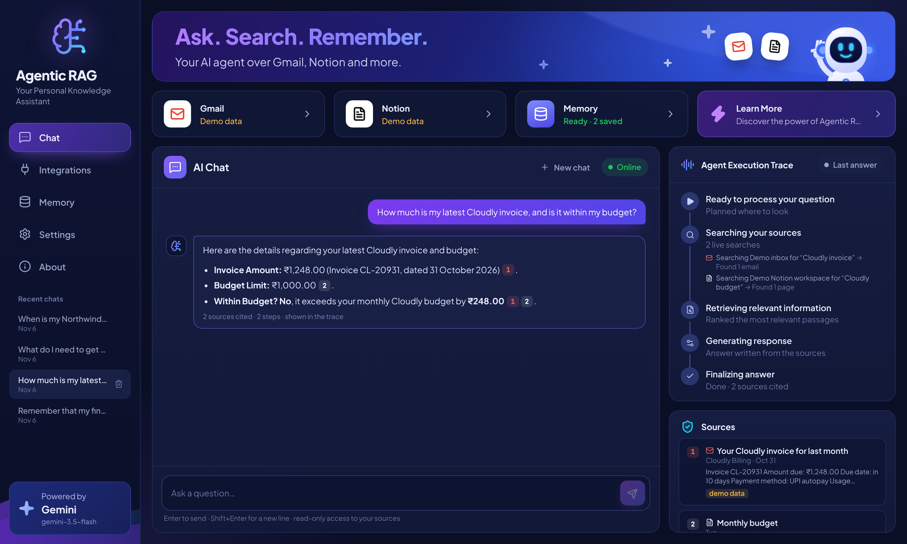
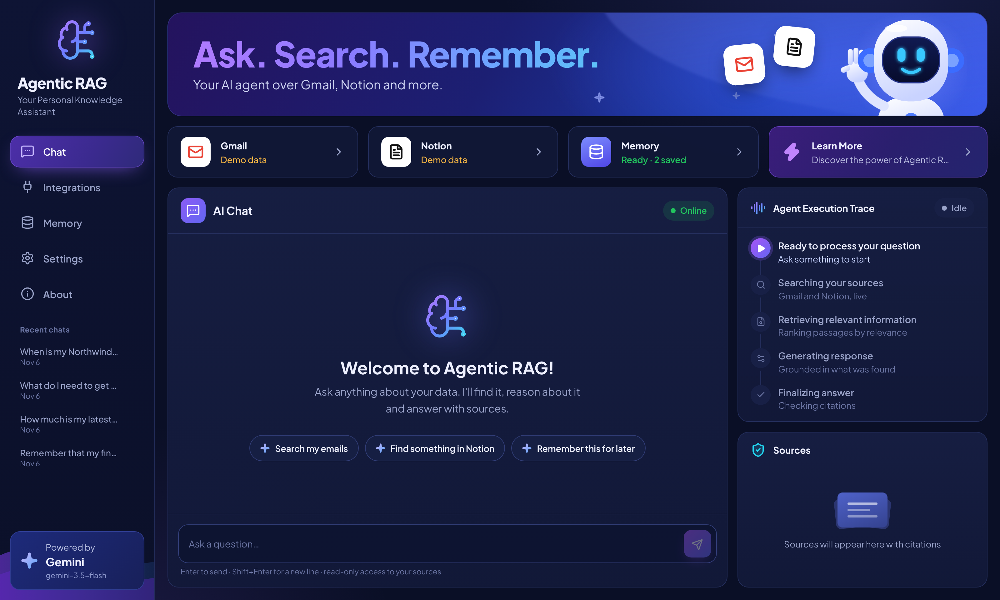
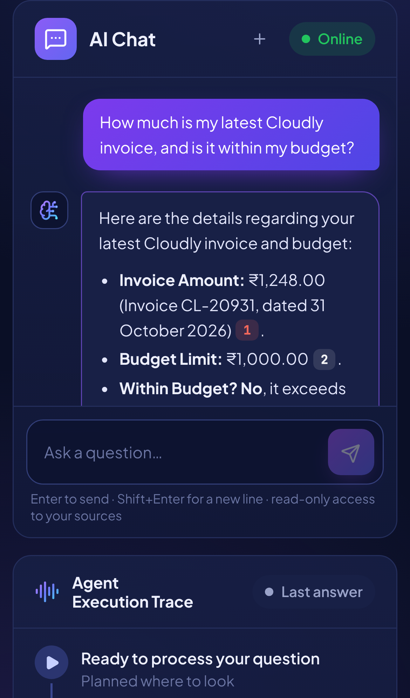
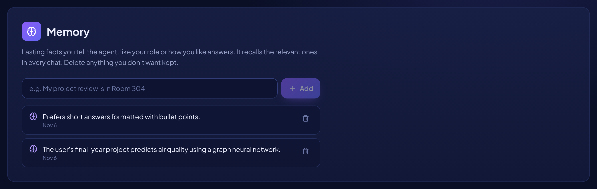

# Agentic RAG over Live Data and Memory

An AI agent that answers questions using **live data from your Gmail and Notion** rather than static PDF documents. For each question it decides what to search, reads what it finds, and writes an answer **grounded in that content, with numbered citations** you can open and check. It also keeps a **long-term memory** of lasting facts you tell it about yourself.

Built with Python, FastAPI, React, TypeScript, Tailwind CSS, Google Gemini (tool calling and embeddings), the Gmail and Notion APIs with OAuth 2.0, and SQLite.

> Ask *"When is my Northwind interview, and what should I revise?"* and the agent searches Gmail for the invitation, then Notion for your prep notes. It answers with the date, time and topics, citing the email as [1] and the page as [2].



<p align="center">
  
  &nbsp;
  
</p>
<p align="center">
  
</p>

<sub>The screenshots use the built-in demo inbox and Notion workspace, which are fictional. The answers were written by Gemini (gemini-3.5-flash).</sub>

## Features

- **Agentic retrieval.** The model plans its own searches with tool calling. It writes Gmail queries with operators (`from:`, `newer_than:7d`, `has:attachment`), retries with other words when a search comes up empty, combines several sources, and reads full items when an excerpt isn't enough.
- **Live data, not a stale index.** Gmail and Notion are searched at question time through their APIs, so answers reflect what's there now. Retrieved emails and pages are split into chunks and ranked against the question with **hybrid search** (BM25 keyword scores plus Gemini embeddings), so the model reads the most relevant passages.
- **Grounded answers with citations.** Every fact is tied to a numbered source. Citation numbers stay fixed for the whole conversation, so follow-ups like *"is that within my budget?"* can build on earlier sources. Unknown citation numbers are removed before the answer is shown.
- **Long-term memory.** When you tell the agent a lasting fact or preference, it saves it, and relevant memories are recalled in later chats. You can view, add and delete memories in the app.
- **Transparent reasoning.** The UI streams the agent's steps live: what it searched, how many results came back, and what it read.
- **Secure by design.**
  - Gmail uses the read-only scope, and the agent has no tools that send, edit or delete.
  - OAuth tokens are encrypted at rest (Fernet), and OAuth `state` checks guard against forged sign-in callbacks.
  - Email and page content is treated as untrusted data, so instructions hidden in an email are ignored, a defence against prompt injection.
  - Everything runs on your own computer.
- **Demo mode.** A fictional sample inbox and Notion workspace let you try it with only a Gemini key.

## Quick start (Windows PowerShell)

You need **Python 3.10+** and **Node.js 22.12+**.

### 1. Get a Gemini API key

Create a free key at [Google AI Studio](https://aistudio.google.com/apikey).

### 2. Start the backend

```powershell
cd backend
python -m venv .venv
.venv\Scripts\python -m pip install -r requirements.txt
copy .env.example .env
notepad .env        # paste your key after LLM_API_KEY=
.venv\Scripts\python -m uvicorn app.main:app --reload --host 127.0.0.1 --port 8000
```

### 3. Start the frontend (in a second terminal)

```powershell
cd frontend
npm install
npm run dev
```

Open **http://localhost:5173**. With demo mode on, try the suggested questions straight away.

**One-server option:** run `npm run build` in `frontend`, set `FRONTEND_URL=http://localhost:8000` in `backend/.env`, and the backend serves the app at http://localhost:8000.

## Connect Gmail

1. In [Google Cloud Console](https://console.cloud.google.com/), create a project.
2. Go to **APIs & Services → Library**, search for **Gmail API**, and click **Enable**.
3. Set up **OAuth consent screen**:
   - **User type:** External
   - **App name** and your email: anything
   - **Test users:** add your own Gmail address. While the app is in testing, only test users can sign in.
4. Go to **Credentials → Create credentials → OAuth client ID**:
   - **Application type:** Web application
   - **Authorized redirect URI:** `http://localhost:8000/api/oauth/google/callback`
5. Copy the client ID and secret into `backend/.env` as `GOOGLE_CLIENT_ID` and `GOOGLE_CLIENT_SECRET`, then restart the backend.
6. In the app, open **Integrations → Connect Gmail**. Google warns that it hasn't verified the app. That's expected for your own testing app, so choose **Continue** and allow read access.

The app only asks for `gmail.readonly`.

## Connect Notion

**Option A: internal integration (quickest)**

1. Go to [notion.so/profile/integrations](https://www.notion.so/profile/integrations) and choose **New integration**. Pick your workspace and set the type to **Internal**.
2. Copy the **Internal Integration Secret** into `backend/.env` as `NOTION_TOKEN`, then restart the backend.
3. In Notion, open each page you want the agent to see, then choose **••• → Connections** and add your integration. Sub-pages are included.

**Option B: connect with a button (OAuth)**

Create a **Public** integration instead, with the redirect URI `http://localhost:8000/api/oauth/notion/callback`. Put its client ID and secret in `NOTION_CLIENT_ID` and `NOTION_CLIENT_SECRET`, then use **Integrations → Connect Notion** in the app.

## How it works

```
question ─► recall relevant memories ─► Gemini plans with tools
              ├─ search_gmail(query)   ─► Gmail API (live) ─┐
              ├─ search_notion(query)  ─► Notion API (live) ─┤─► chunk ─► rank (BM25 + embeddings)
              ├─ read_source(n)        ─► full text / best passages ┘        │
              ├─ save_memory(fact) · search_memory(query)                    ▼
              └─ … repeats up to 6 steps ◄──── numbered excerpts in <source> tags
         ─► final answer with [n] citations ─► validated ─► streamed to the UI
```

| Part | File | What it does |
| --- | --- | --- |
| Agent loop | `backend/app/agent.py` | Tool calling, source numbering, citation checks, step events |
| Model client | `backend/app/llm.py` | OpenAI-compatible chat and embeddings, with retries and clear errors |
| Retrieval | `backend/app/retrieval.py` | Chunking, BM25, cosine similarity, hybrid ranking |
| Memory | `backend/app/memory.py` | Saving (with duplicate detection) and relevance-based recall |
| Gmail | `backend/app/sources/gmail.py` | OAuth with token refresh, search, MIME and HTML parsing, quoted-reply stripping |
| Notion | `backend/app/sources/notion.py` | OAuth or token, search with a content fallback, nested block text |
| API | `backend/app/main.py` | REST endpoints, OAuth callbacks, a Server-Sent Events stream of the agent's work |
| UI | `frontend/src` | Chat with citation chips, a live Agent Execution Trace, a Sources panel, and Integrations, Memory, Settings and About pages |

**Gemini 3 and thought signatures.** Gemini 3 attaches encrypted "thought signatures" to its tool calls, and they must be sent back unchanged on the next request. The client calls the API over plain HTTP and keeps each assistant message exactly as returned, so signatures are preserved without special handling.

**Busy models.** Google sometimes reports "high demand" for a model, or a free-tier rate limit is hit. When that happens, the app switches straight to a backup model (`LLM_FALLBACK_MODEL`, by default `gemini-3.1-flash-lite`) for 10 minutes instead of waiting. Run `.venv\Scripts\python check_model.py` in `backend` to see how quickly each model answers for your key.

**Speed and free-tier limits.** On Gemini the agent asks for low thinking effort (`LLM_REASONING_EFFORT=low`), which keeps each step to a few seconds; raise it in `.env` if you want deeper reasoning. Each answer uses about 2–4 model calls. If Gemini's free tier rate limit is hit, the app retries briefly and then asks you to wait a minute. If embeddings are unavailable, ranking falls back to keyword search automatically.

## Use another model

Set `LLM_PROVIDER` in `backend/.env` to `openai`, `anthropic` or `ollama` (local), and set `LLM_MODEL` and `LLM_API_KEY` to match. All four are reached through OpenAI-compatible endpoints. `LLM_BASE_URL` overrides the endpoint for any other compatible provider.

## Tests

```powershell
cd backend;  .venv\Scripts\python -m pip install -r requirements-dev.txt;  .venv\Scripts\python -m pytest
cd frontend; npm test
```

The 45 backend tests cover:
- the agent loop, using a scripted model, including thought-signature passthrough and multi-turn source numbering
- Gmail and Notion parsing against mocked APIs
- OAuth state checks and token encryption
- retries, timeouts, the backup model and error messages
- hybrid ranking and memory recall

## Project structure

```
backend/
  app/             FastAPI app, agent, retrieval, memory, sources (gmail, notion, demo)
  tests/           pytest suite
  .env.example     settings template
  data/            created at runtime: SQLite database and encryption secret (git-ignored)
frontend/
  src/             React + TypeScript UI
docs/
  screenshots/     images used in this README
```

## Notes

- This is a single-user app meant to run on your own computer (`127.0.0.1`). Add authentication before putting it on a public server.
- The demo inbox and Notion pages are fictional and are shown with a **demo data** label.
